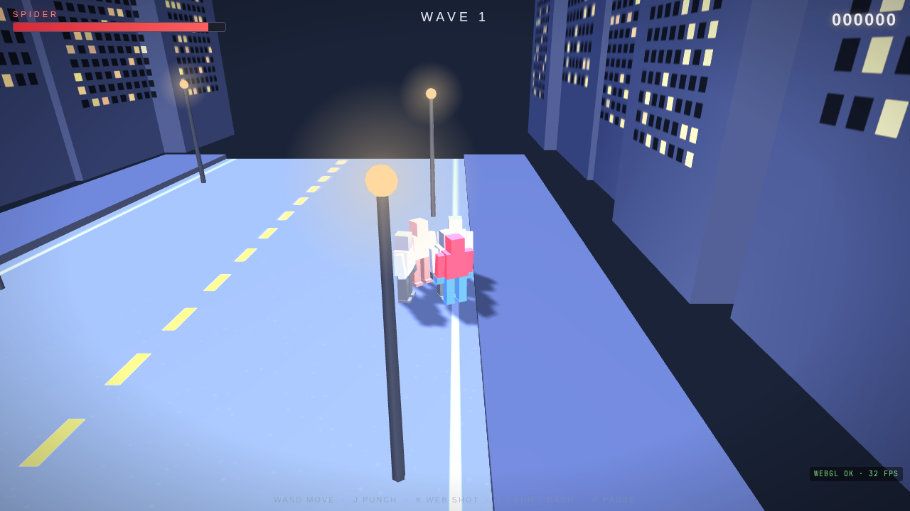

# WEB SLINGERS

A spider-powered 3D beat 'em up that runs entirely in the browser. Sling webs,
throw punches and dash through endless waves of spider-thugs — and face
**Dr. Octavius** every fifth wave.

Built with [three.js](https://threejs.org/) in a single HTML file. No build
step, no dependencies to install.



 

## Play

Just open `index.html` in any WebGL-capable browser — or serve the folder:

```bash
python3 -m http.server 8000
# then visit http://localhost:8000
```

## Controls

| Key            | Action     |
| -------------- | ---------- |
| `W A S D` / arrows | Move   |
| `J`            | Punch      |
| `K` / `X`      | Web shot   |
| `L` / `Shift`  | Dash       |
| `P`            | Pause      |

## Gameplay

- **Waves** of enemies with escalating difficulty; clear a wave for a score bonus.
- **Enemy types**
  - *Thug* — standard grunt
  - *Crawler* — fast and low
  - *Brute* — slow, heavy hitter
  - *Dr. Octavius* — tentacled boss every 5th wave
- **Combo system** — chain kills quickly for up to a 2× score multiplier.
- Procedural sound effects via the Web Audio API (no asset files).

## Tech notes

- `index.html` — the entire game: rendering, input, AI, waves, HUD and audio.
- `three.min.js` — bundled three.js runtime so the game works offline.
- All characters, effects and arenas are generated procedurally — zero art assets.

## License

No license has been chosen yet — all rights reserved by the author.
